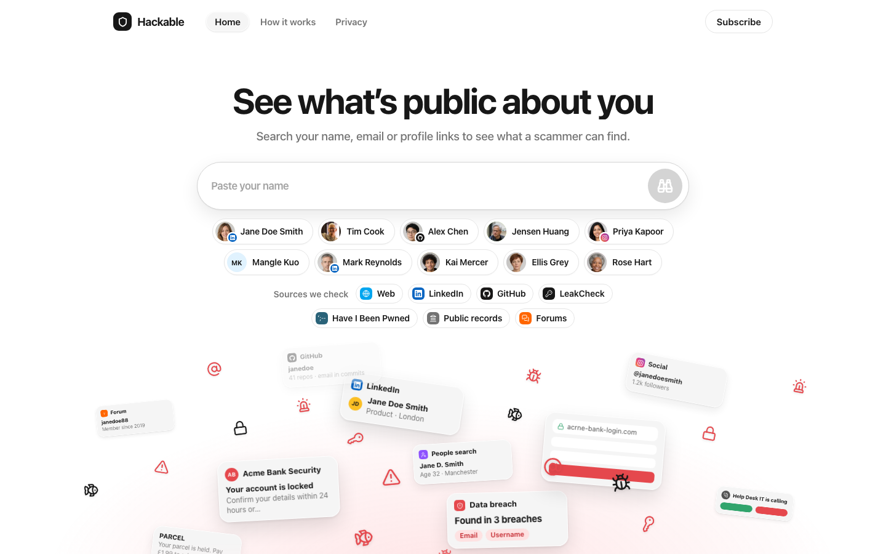
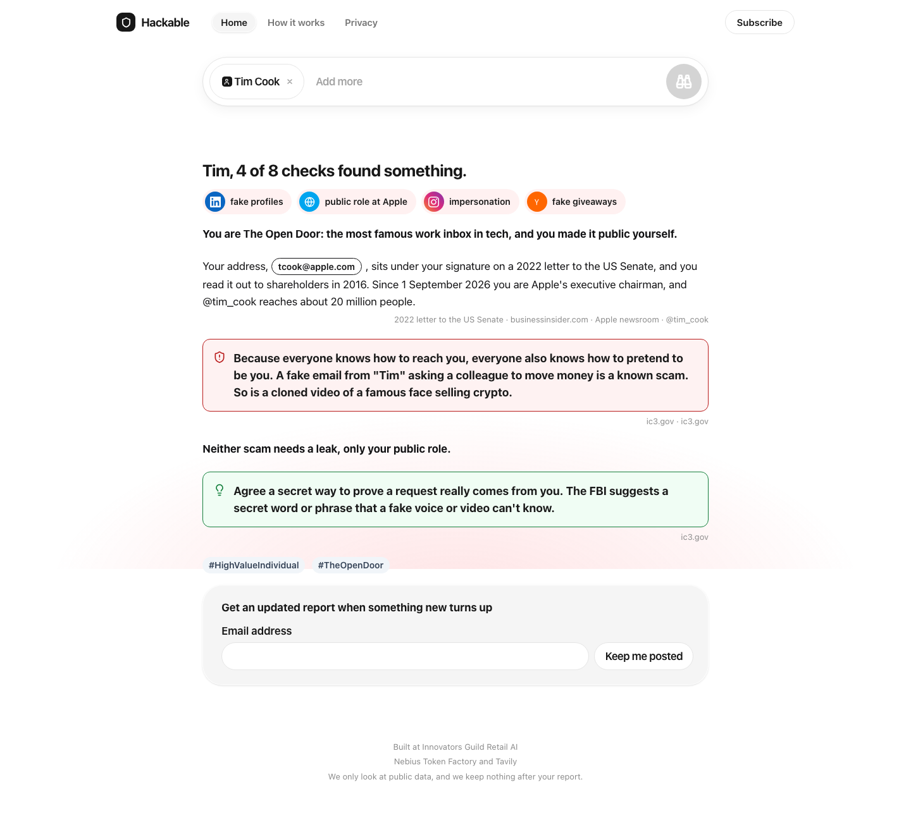
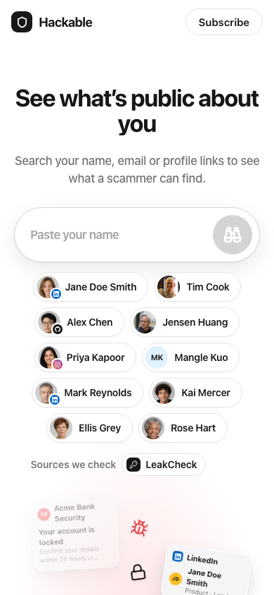
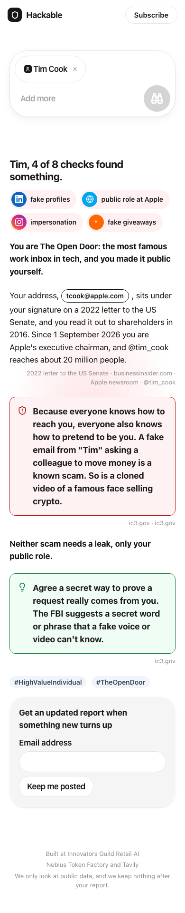

# Hackable

Hackable is a personal exposure check. Type an email, name or username and it checks public sources and breach data, then shows a short report, a bit like an MBTI result, of what a scammer could find about you and which scam patterns could follow. Every claim links to its source.

Built solo in one evening at the Innovators Guild Retail AI and Agents Hackathon, Hackable won the Agentic AI track and was one of two track winners. It uses Nebius Token Factory, Nemotron and Tavily.



## Try it

Live: https://mangle-hackable.vercel.app

Live searches need the API keys below set on the server. The presets work without them.

Run it locally:

```bash
pnpm install
pnpm dev
```

Then open http://localhost:3000.

Copy `.env.example` to `.env.local` and fill in only what you have. With nothing set, the app uses a mock model and synthetic results.

| Variable | Use |
| --- | --- |
| `SCAN_MODE` | Set to `live` to run real public checks |
| `NEBIUS_API_KEY` | Nebius Token Factory key for the Nemotron report |
| `NEBIUS_MODEL` | Optional, defaults to `nvidia/nemotron-3-super-120b-a12b` |
| `TAVILY_API_KEY` | Web and news search (falls back to DuckDuckGo without it) |
| `GITHUB_TOKEN` | Optional, raises GitHub API limits |

## How to test

1. Open the landing page.
2. Tap the Jensen Huang preset and read the report.
3. Press Back to return to the landing page.

The other presets are Tim Cook, Mangle Kuo and Jane Doe Smith, who is synthetic.

Checks:

```bash
pnpm exec vitest run   # renderer unit tests: 278 passed
pnpm exec tsc --noEmit # type check: passes
pnpm lint
```

## Explore

- [Scam patterns](http://localhost:3000/patterns)
- [How it works](http://localhost:3000/how-it-works)
- [Privacy](http://localhost:3000/privacy)

The renderer tests run fixed inputs through the clean up pass: well formed reports plus messy ones such as fenced output, headings, unknown alert types, five cards, missing footnotes, raw HTML and JSON instead of markdown.



<p>
  
  
</p>

## How it works

1. **Identify.** The search box splits what you type into emails, usernames, GitHub handles and names.
2. **Check public sources.** Each check runs with a short deadline and reports "could not check" rather than failing:
   LeakCheck and XposedOrNot (breach names), Hudson Rock Cavalier (infostealer logs), GitHub public API (profiles and public commit emails), Gravatar, Keybase, Hacker News, and Tavily web and news search.
3. **Reason.** Nemotron on Nebius Token Factory writes the report from the real findings only, matched against 24 scam patterns in 6 groups (work and money, logins, calls and impersonation, crypto and romance, life events and news, other).
4. **Report.** The model writes plain GitHub flavoured markdown. Each card is a GitHub alert (warning for a leak, caution for a scam pattern, tip for the one lesson, note for a detail) with footnote links to sources.
5. **Clean up and render.** Before rendering, a pure clean up pass strips code fences, turns headings into bold lines, maps unknown alert types to notes, drops links not on the source list and orphaned footnotes, keeps at most three cards, and splits long cards at sentence ends so no card fills the screen. It is rendered with react-markdown and remark-gfm, with no raw HTML.

## Stack

Next.js 16, React 19, TypeScript, Tailwind CSS 4, Vercel AI SDK with an OpenAI compatible provider for Nebius, Nemotron, Tavily, react-markdown with remark-gfm, Zod, Vitest and Playwright.

## Privacy

- Public data only. Live mode reads public APIs and never returns synthetic data.
- Nothing is stored. Results live in the page and are gone when you leave.
- The public figure presets (Tim Cook, Jensen Huang) use public role facts only and make no breach claims. Jane Doe Smith is synthetic. Mangle Kuo's preset is the author's own data, shared with consent.
- The subscribe card is a mock. It sends nothing.
- Keys are read from the server environment and never logged.

## Licence

The licence has not been decided yet.
